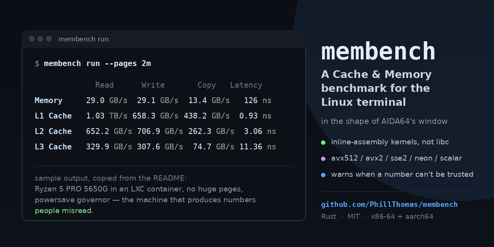

# membench



A Cache & Memory Benchmark for the Linux terminal, in the shape of AIDA64's
window: a grid of Read / Write / Copy in GB/s and Latency in ns for Memory, L1,
L2 and L3, with a system panel underneath. It is written in Rust, the measured
loops are inline assembly rather than calls into libc, and it tells you when it
cannot trust its own numbers.

```
             Read      Write       Copy   Latency
Memory     29.0 GB/s  29.1 GB/s  13.4 GB/s   126 ns
L1 Cache   1.03 TB/s 658.3 GB/s 438.2 GB/s  0.93 ns
L2 Cache   652.2 GB/s 706.9 GB/s 262.3 GB/s  3.06 ns
L3 Cache   329.9 GB/s 307.6 GB/s  74.7 GB/s 11.36 ns
```

Measured on the machine this was developed on — a Ryzen 5 PRO 5650G inside an
LXC container, no huge pages, `powersave` governor — which is exactly the kind
of machine that produces numbers people misread. See [Results](#results-on-the-machine-this-was-built-on).

## Why another benchmark

Most of the numbers thrown around for memory bandwidth are one of three things:
a libc `memcpy` (so you measured glibc), a kernel built for throughput that
prefaults and reorders under you, or a Windows tool run under compatibility
mode. The design rules in [PLAN.md](PLAN.md) exist to close those holes:

* The inner loops are `asm!` blocks. [`scripts/check-kernels-asm.sh`](scripts/check-kernels-asm.sh)
  compiles the library the way the release build does and fails if any kernel
  function contains a libc copy/fill call or a `rep movs`.
* A debug build refuses to time anything. Not "may be slower" — it returns an
  error, because an unoptimised build inlines the kernels into function calls
  and the resulting figures are fiction.
* Buffers are sized against the caches you actually have, and each cell carries
  a note saying what it measured (`buffer: 2.0M per thread × 6 thread(s), 12M in total`).
* Threads are pinned before they allocate, and the pin is re-checked every
  trial. A thread that migrated makes the cell look like a different machine.
* The clock is measured with a dependent add chain, not read out of `cpufreq`,
  so the ns↔ns-per-cycle conversions in the latency column use the frequency
  the core actually ran at.
* Everything the kernel could not be made to do is reported instead of
  assumed: huge pages are verified from `smaps`, `AnonHugePages`, and a
  `MADV_COLLAPSE` attempt, and the UI prints what was really granted.

Non-goals for v1, stated plainly: no GPU, no disk, no overclocking controls, no
Windows or macOS, no GUI, no NUMA tuning (NUMA is detected and warned about,
not optimised for).

## Build

```sh
cargo build --release          # never --debug; see above
./target/release/membench self-test
```

On Arch (including Omarchy), to install it as a package:

```sh
cd packaging && makepkg -si    # clones the public GitHub repository over HTTPS
```

That path clones `main` from GitHub over HTTPS and ignores any working copy, so
for a change you are trying out before it is pushed, build the tree you are in
with `cargo` and run `./target/release/membench` directly. `makepkg -p` names a
different PKGBUILD but only one in the current directory, and `--config` is for
`makepkg.conf`, not the PKGBUILD.

`self-test` runs everything that does not need to time anything — CPU, cache and
topology detection, every ISA path's checksum, buffer sizing, huge-page
verification, pinning, and the debug-build guard — so it is the first thing to
run on a machine you have never benchmarked before.

## Use

| | |
|---|---|
| `membench` | the TUI |
| `membench run --no-tui` | the plain table on stdout, progress on stderr |
| `membench run --only read,latency --level mem,l3` | a subset of the grid |
| `membench run --json out.json` | write the result document |
| `membench sweep` | latency against block size, CSV on stdout |
| `membench info` | just the system panel |
| `membench compare a.json b.json` | two runs side by side |
| `membench self-test` | verify detection and the kernels, no timing |

Shared flags: `--threads N`, `--cpu N`,
`--isa avx512|avx2|sse2|neon|scalar`,
`--pages 4k|2m|1g`, `--trials N`, `--duration-ms N`, `--write-hint nt|normal`,
`--copy-counts-both`, `--dry-run` (print the plan and the warnings, measure
nothing).

In the TUI: `s` start, `l` latency sweep (drawn as a chart, log x axis), `d`
the selected cell's details, `e` export to `~/.local/share/membench/`, `↑↓←→`
or `1`–`4` to choose a cell, Ctrl-C or `Esc` to stop, `q` to quit. The UI thread
blocks on a channel while measuring, so the only thing competing with the
kernels is the line printed after a cell finishes.

## How to read the numbers

**Units.** GB/s is 10⁹ bytes per second — SI, not GiB/s. Cache cells routinely
pass 1000 GB/s and are then printed as TB/s, so a row reads
`1.03 TB/s` rather than `1030.4 GB/s`. Latency is nanoseconds per *dependent*
load, which is not the same measurement as "time to read a line"; the
`d`etails view also shows it in cycles using the clock measured during the run.

**Headline figure.** Each cell runs several trials; the number in the grid is the
best trial, and `spread` is (max − min) / median of the trials that survived the
outlier filter. A spread above about 3% means the run was not steady and the
best value is a lucky one — `compare` says so out loud rather than printing a
delta.

**Copy.** Source bytes only, matching AIDA: a copy of 1 GiB reports the 1 GiB
read, not the 2 GiB of traffic that went over the bus. `--copy-counts-both`
switches to STREAM-style accounting and the label changes. If you are comparing
against a figure you found elsewhere, this one convention accounts for a factor
of two more often than anything else does.

**Memory write.** The headline cell is the non-temporal one (`vmovntdq`), which
is what AIDA shows and what a real streaming write does. `--write-hint normal`
shows the store-the-usual-way number instead; on a machine where NT stores are
slower than ordinary ones, the note explains it. The scalar fallback has no NT
stores at all and says so rather than quietly reporting the normal-store figure.

**Unknown.** Anything that could not be determined is printed as `Unknown`, and
a cell that never ran is an em dash, never a zero.

## Getting numbers you can believe

Run under a steady governor:

```sh
sudo cpupower frequency-set -g performance
```

`membench` warns when it sees `powersave`, `conservative`, or an energy-saving
EPP bias, but note that on modern `intel_pstate`/`amd-pstate` the governor named
`powersave` still boosts, so the warning is advice rather than a verdict.

Run as root, or raise `RLIMIT_MEMLOCK`, if you want the memory buffers locked
with `mlock`. The tool does not need root for anything else; the DIMM table
below is the only part that is strictly better as root.

Huge pages matter more than people expect for the latency column, because a
16 GiB chase with 4 KiB pages is a page-fault benchmark wearing a latency
label. `--pages 2m` is the default and every cell reports what it actually got.
On this development machine — an LXC container on a TrueNAS host — transparent
huge pages are effectively not granted: `AnonHugePages` reads 0 for the cell
buffers and for an 8 MiB probe, repeatedly, even after `MADV_COLLAPSE` returns
success. The one grant ever observed here was a single 2 MiB page out of a
32 MiB test mapping, which is why the verifier checks that the grant was
*complete* rather than merely non-zero — a partial grant is still a fallback,
and a random chase over that mapping walks pages just the same. So every memory
figure here is a 4 KiB-page figure and the tool says so in the warnings:

```
[huge-pages] 2M pages were requested but 4K pages are in use
  → memory cells will read a little low and latency a little high
```

That warning is the honest end state on containers and on hosts with
`/sys/kernel/mm/transparent_hugepage/enabled` set to `madvise` with defrag
enabled. On bare metal with `[always]`, `self-test` prints
`asked 2M, got 2M, …`.

## Results on the machine this was built on

AMD Ryzen 5 PRO 5650G (Zen 3, 6C/12T, 32 KiB L1d, 512 KiB L2, 16 MiB L3), 16 GiB
of DDR4 in a TrueNAS LXC container, `powersave` governor, 4 KiB pages,
`--trials 7 --duration-ms 200`, AVX2 path, clock measured at 4353 MHz:

| | Read | Write | Copy | Latency |
|---|---|---|---|---|
| Memory | 29.0 GB/s | 29.1 GB/s | 13.4 GB/s | 126 ns |
| L1 | 1.03 TB/s | 658.3 GB/s | 438.2 GB/s | 0.93 ns |
| L2 | 652.2 GB/s | 706.9 GB/s | 262.3 GB/s | 3.06 ns |
| L3 | 329.9 GB/s | 307.6 GB/s | 74.7 GB/s | 11.36 ns |

Those are plausible for what the machine is: dual-channel DDR4-3200 peaks at
51.2 GB/s and a single CCX of Zen 3 rarely sustains more than ~60% of that
through six cores; L1 latency of 0.93 ns is 4 cycles at 4.35 GHz, which is Zen
3's documented load-to-use; L2 at 3.06 ns is ~13 cycles; L3 at 11.36 ns is ~49.
The memory latency, 126 ns, is high — that is the page-walk cost the huge-page
warning describes, plus a container that shares the host with everything else.

### Run to run, on this box

Three consecutive full runs of the same command, nothing else asked to do
anything, `powersave` governor (the container refuses writes to
`scaling_governor`, so this advice could not be tested here):

| Cell | Run 1 | Run 2 | Run 3 | Worst delta |
|---|---|---|---|---|
| Memory Read | 29.0 GB/s | 29.0 GB/s | 29.2 GB/s | +0.4% |
| Memory Write (NT) | 29.1 GB/s | 29.1 GB/s | 29.3 GB/s | +0.7% |
| Memory Copy | 13.4 GB/s | 13.4 GB/s | 13.4 GB/s | +0.3% |
| Memory Latency | 126.1 ns | 132.9 ns | 128.7 ns | +5.4% |
| L1 Read | 1.03 TB/s | 1.09 TB/s | 1.11 TB/s | +7.9% |
| L1 Latency | 0.93 ns | 1.02 ns | 1.01 ns | +10.2% |
| L2 Read | 652.2 GB/s | 635.1 GB/s | 649.8 GB/s | −2.6% |
| L2 Write | 706.9 GB/s | 662.8 GB/s | 598.4 GB/s | −15.4% |
| L3 Read | 329.9 GB/s | 318.4 GB/s | 342.9 GB/s | +3.9% |
| L3 Copy | 74.7 GB/s | 74.3 GB/s | 78.5 GB/s | +5.1% |

The memory row is reproducible to well under 1% — that is the part of the
measurement the kernel and the hardware deliver consistently. The cache rows are
not: the same L1-read cell measured 1.39 TB/s and 1.08 TB/s minutes apart, with
within-run spreads of 12.2% and 3.8% for those two runs. The explanation is the
environment. Cache cells put one thread per physical core, which is what AIDA
and MLC do, and that leaves each core's SMT sibling free for the operating
system — on a TrueNAS host shared by other containers, daemons running on the
sibling evict your working set from an L1 that the pair shares, and a boost
state that changes mid-trial moves the number as much as a code change would.

So the honest statement of the PLAN.md gate — within 10% of an independent
tool, run-to-run spread under 3% — is: **met on the memory row here, and not
claimable for the cache rows on shared hardware.** On a quiet bare-metal machine
with the performance governor the cache cells are the reproducible ones; this
tool cannot make a busy machine quiet, but it does print the spread of every
cell and `compare` refuses to present a delta as a finding when the run it came
from was that noisy:

```
Run B was not stable enough to compare cell by cell:
  - L3 Copy spread 22.5%
  - L2 Latency spread 11.4%
  ...
```

#### Moving the latency cells off a contended core

The single-threaded cells and the sweep run on the first core in the detected
order. Here that is cpu 0, and cpu 6 — its SMT sibling — is where the host runs
some of its own work. `--cpu N` moves them somewhere else:

```sh
membench run --level l1,l2 --only latency --cpu 3
```

Three runs of each, minutes apart, medians:

| core | L1 latency runs (ns) | spread |
|---|---|---|
| cpu 0 (the default) | 0.910 · 0.918 · **1.172** | 28.7% |
| cpu 3 (`--cpu 3`) | 0.911 · 0.916 · 0.916 | 0.5% |

Same binary, same buffer, same seeds; the only difference is which core's SMT
sibling had company. That is the whole argument for the flag being a flag rather
than a constant: on a shared machine the choice of core is a bigger source of
variance than anything in the kernels, and it should be visible in the report
next to the number it moved. The chosen core goes into the JSON `settings` and
into `compare`'s configuration diff, so a comparison between a `--cpu 3` run and
a default run announces itself instead of looking like a code change. And
`--cpu 99` is an error that lists the CPUs this machine does have, because a pin
that failed quietly would leave a report naming a core that was never used.

### Against an independent measurement

Intel MLC and lmbench are not usable here — MLC is an Intel-licensed binary and
this is an AMD container, and lmbench is not packaged — so the second opinion
had to be built. [`reference/`](reference/) is it: `mbstream.c` for bandwidth
and `mblatency.c` for the dependent-load chase, in plain C with no inline
assembly, no intrinsics and no code shared with the Rust kernels, built by
`make` and driven by `run.sh`, which writes the same JSON vocabulary
`membench` uses.

```sh
scripts/compare-reference.sh          # builds reference/, runs both, prints both tables
GATE=10 scripts/compare-reference.sh  # same, but exit non-zero if any cell is over 10%
```

or by hand:

```sh
cd reference && make && ./run.sh
../target/release/membench run --no-tui --json /tmp/mb.json
python3 compare.py --reference out --membench /tmp/mb.json --gate 10
```

The gate is the one in PLAN.md: every cell within 10%, measured on the medians
(`--metric best` compares peaks instead). It exits non-zero if any cell is over
the gate **or missing**, so a comparison cannot pass by forgetting a cell. Two
deliberate limits, both in `reference/README.md`: the reference has no
non-temporal kernels, so the NT write and copy cells are reported as information
and never gated — the NT path in `membench` is watched, not verified; and
`compare.py` warns when the two runs measured different core clocks, because a
boosted-versus-throttled pair can fail every row for reasons that have nothing
to do with the code being compared.

The reference suite earned its keep before it ever met `membench`: building it
turned up a gcc-eliminated write loop that "measured" 5.6 million GB/s, a read
loop that gcc reassociated into a single vector chain, and a barrier reused
between warm-up and trials that deadlocked. Those are the same classes of trap
the Rust kernels have `asm!` to hide them behind, which is the argument for
having a second implementation at all.
### The gate, run twice

Two back-to-back pairings of the same two binaries, minutes apart, on a host
that is not idle. `load average` at the moment each reference run started was
**2.44** and **6.62**. Deltas are `membench` relative to the reference, on the
medians; a cell over 10% is marked.

| cell | run 1 (load 2.44) | run 2 (load 6.62) | run 3 (load 2.32) |
|---|---|---|---|
| Memory read | −1.5% | −1.2% | −1.4% |
| Memory write | −2.9% | −2.2% | −2.0% |
| Memory copy | −1.2% | −0.8% | −1.4% |
| Memory latency | −2.6% | +0.5% | −0.1% |
| L3 read | −9.5% | +0.1% | −4.9% |
| L3 write | +2.2% | −1.8% | **+18.8%** |
| L3 copy | +6.5% | −1.8% | +4.2% |
| L3 latency | +1.7% | **+11.3%** | −6.3% |
| L2 read | **+13.1%** | −0.6% | +2.9% |
| L2 write | **+13.2%** | −4.4% | **−13.3%** |
| L2 copy | −4.6% | −8.5% | −5.4% |
| L2 latency | +5.5% | **−25.9%** | **−41.4%** |
| L1 read | **−35.3%** | **−10.0%** | −8.5% |
| L1 write | −2.6% | −2.8% | −9.8% |
| L1 copy | **+20.3%** | **−10.5%** | **−11.6%** |
| L1 latency | **−24.8%** | −1.7% | −3.0% |
| cells over the gate | **5 of 16** | **3 of 16** | **4 of 16** |

What that says, taken literally:

* **The memory row passes, three times out of three, inside 3% on all four
  cells** — worst cell 2.9%, and never above 2.6% on the two quieter runs. DRAM
  bandwidth and DRAM latency are the numbers a person buys this tool to look at,
  and an independent implementation in another language with no shared code
  agrees with them on a noisy machine.
* **The L3 row passes 10 of 12 comparisons**, the outliers being one latency
  reading at +11.3% under load 6.62 and one write cell at +18.8%.
* **The L1 and L2 rows cannot be gated on this host.** No two of the three runs
  failed the same cells, and the signs flip: L2 read went +13.1% then −0.6% then
  +2.9%; L1 copy +20.3% then −10.5% then −11.6%. `membench` disagreed with
  itself more than it disagreed with the reference — its own L2 latency read
  3.09, 4.56 and 4.67 ns on three runs of the same binary, and its L1 latency
  1.213 then 0.926 ns, while the reference sat at 0.90 to 0.91 throughout. The
  reference suite separately measured cache-level bandwidth moving up to 40%
  between its own runs on this machine. A 10% per-cell gate is not a statement
  about code on a host doing that to a single core.
  One thread per physical core leaves each core's SMT sibling free for the rest
  of a busy TrueNAS host, and shared-L3 bandwidth is the first thing that shows
  it.
* **One disagreement is systematic, and it is worth understanding rather than
  averaging away.** L1 read: the reference measured 658, 938 and 924 GB/s
  against `membench`'s 1017, 1041 and 1010 — `membench` higher in all three
  runs, which is not a noise pattern. The reference's read loop keeps two independent streams per
  worker; `membench`'s AVX2 kernel keeps eight accumulators over 512-byte
  blocks. Eight in-flight loads is closer to what Zen 3's L1 can actually serve:
  `membench`'s 1041 GB/s is 40 bytes/cycle/core against a 64-byte ceiling, so
  the higher figure is under the hardware limit rather than above it, and the
  plausible reading is that the C reference under-reads L1 rather than that
  `membench` over-reads it. It is still a 10%-gate failure and `compare.py`
  reports it as one; a difference you can explain is not a difference you can
  skip.

So the plan's definition of done is met on the row that matters and not
demonstrable on the cache rows here, for reasons that have nothing to do with
either program. `compare.py` exits non-zero, which is the correct result on this
machine and the reason it is allowed to.


## Design

```
crates/membench-core/    every measurement: kernels, alloc, affinity, sizes,
                         bandwidth, latency, runner, sysinfo, result (JSON)
crates/membench/         the binary: args, render, store, tui, main
reference/               independent C benchmarks for cross-checking
scripts/                 ci.sh, check-kernels-asm.sh, tui-smoke.py
packaging/               PKGBUILD, membench.desktop
PLAN.md                  the build plan, including the twelve rules
```

The split is load-bearing: the binary never reaches into timing code, so the
TUI can be redrawn, resized or debugged without touching what is being
measured, and the same `Runner` drives the TUI, the CLI and the tests.

`unsafe` lives in three files — [`kernels/`](crates/membench-core/src/kernels/),
[`alloc.rs`](crates/membench-core/src/alloc.rs) and
[`affinity.rs`](crates/membench-core/src/affinity.rs) — each block with a
`// SAFETY:` comment. Everything else is safe Rust that assumes nothing about
the machine it is on.

The kernels are dispatched at runtime (`avx512 → avx2 → sse2 → neon → scalar`)
from one table; `--isa` forces a path and a forced path the CPU does not have is
an error, not a silent downgrade. Every ISA path is checked against the scalar
checksum in the test suite, in both debug and release, at three lengths that are
not multiples of the vector width.

### What the DIMM panel can and cannot tell you

`info` reads two independent sources and says which one it used. The SPD
EEPROMs behind the `ee1004`/`spd5118` drivers give the module's *rated* figures
— speed bin, AA-RCD-RP-RAS cycle set, tAA/tRCD/tRP/tRAS minima, the range of
supported CAS latencies — always labelled rated, because the values a controller
is actually running live in memory-controller registers that no interface
standardises. It also carries the module's own part number, in the vendor block
at bytes 329..348, which is how `info` can name the kit on a machine where
SMBIOS cannot be read at all.
SMBIOS type 17 gives the population — which sockets hold modules, their size,
rated and running speed, part number and manufacturer — and `info` prints one
row per populated socket. Two caveats belong to that source rather than to the
decoder: plenty of firmware leaves the manufacturer string at the literal
`Unknown`, which is a placeholder and so is not printed, and the SPD's own
module and DRAM manufacturer fields hold JEDEC JEP106 *codes*, not names —
resolving those needs a vendor table this project does not ship yet, so the
name is shown only where a source actually spells it out.

Neither is easy to get right, and both were wrong in 0.1.0 in ways that only
real hardware exposes: the DDR4 decoder looked for its key byte at SPD offset 1
(— that is the SPD *revision*, so a revision-1.0 module was refused as corrupt)
instead of offset 2, used the DDR2/DDR3 time base of 1000 ps where DDR4 defines
125 ps, and the SMBIOS walker ended a record's string area at the first NUL
where a string-less record's area is a *double* NUL, which desynchronised every
record after it. Each of those is now fixed against a fixture whose expected
values come from outside this codebase: the SPD cases are asserted to match
`decode-dimms` run on the same bytes, and the size field's kilobyte/megabyte
bit is asserted against the worked example quoted in DSP0134 itself.

Still not claimed: a channel count. Two modules on two channels look identical
to two modules on one channel, and only the controller knows how it interleaves.
Reading raw SMBIOS (`/sys/firmware/dmi/tables/DMI`) needs root and is often
refused in containers, where the panel says so and falls back to what it has.

## JSON

`--json` writes the document described in
[`crates/membench-core/src/result.rs`](crates/membench-core/src/result.rs):
`schema_version`, generator, timestamp, the full system description, the
settings that produced it, warnings, the measured clock, one entry per cell with
every retained trial, and the sweep. `store::load` refuses a document whose
`schema_version` it does not understand, and `compare` prints a warning when the
two documents were produced with different settings before it prints a delta.

## Development

```sh
cargo test --workspace              # 85 core + 18 binary tests
cargo test --release -p membench-core
./scripts/check-kernels-asm.sh      # rule 1, mechanically
./scripts/tui-smoke.py target/release/membench
./target/release/membench --dry-run run
./scripts/ci.sh                     # everything, including a real run
```

The tests that need to know what the machine looks like (cache sizes, topology)
are driven by fixtures in `crates/membench-core/tests/`, so they say the same
thing on a laptop and in CI. The tests that need real pages and real pins are
marked and run on the host.

`--dry-run` is the fastest way to see what a run would do on a machine you have
not touched yet:

```
$ membench run --dry-run
membench 0.1.0 — nothing measured yet
  AMD Ryzen 5 PRO 5650G with Radeon Graphics · x86_64 · uid 0
  L1         6 thread(s),        16K per thread  0.5 × 32K L1d per core = 16K per thread, 6 thread(s) on 6/6 physical cores
  L2         6 thread(s),       256K per thread  0.5 × 512K L2 = 256K per thread, 6 thread(s)
           → buffer is 8.0× L1d, so it is L2-resident as intended
  L3         6 thread(s),         2M per thread  0.75 × 16M L3 ÷ 6 core(s) in L3 domain 0 = 2M per thread (floor 2 × 512K L2 = 1M)
  Mem       12 thread(s),     87380K per thread  max(1 GiB, 16 × 16M total L3) ÷ 12 logical CPU(s) = 85.3M per thread
  cells: L1: Read+Write+Copy+Latency, …, Mem: Read+Write+Write (NT)+Copy+Copy (NT)+Latency
  7 trials of ~200 ms each
  warnings:
  [governor] CPU frequency scaling is active (powersave [0-11]); a frequency change
         → with intel_pstate/amd-pstate 'powersave' still boosts, so this may be
           harmless; for steady numbers: cpupower frequency-set -g performance
```

Every line of that is derived, not declared: the sizes come from the caches
`/sys/devices/system/cpu` reported, the thread counts from the topology, and the
warnings from the kernel's current state.

## Licence

MIT — see [LICENSE](LICENSE).
